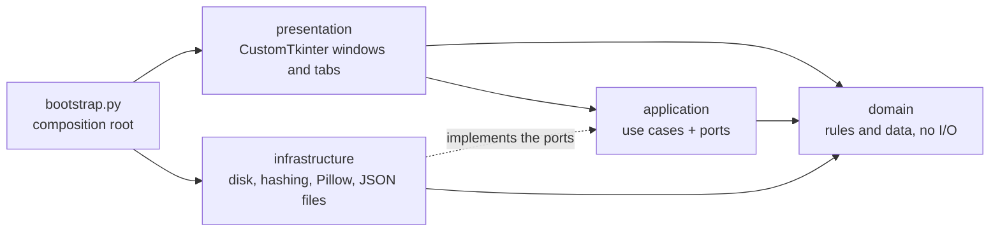

# Duplicate Finder

**English** · [Español](README.es.md)

[](https://github.com/Sayessol/buscador-de-duplicados/actions/workflows/tests.yml)


A Windows desktop app that **finds duplicate files and similar photos** and helps you tidy them up safely.

> **Golden rule: the app never deletes or modifies your original files.**
> It only reads, and only *moves* files to a quarantine folder when you confirm. Everything can be undone.
>
> The only time the app deletes anything is when you **undo a copy**: it removes the copies it created itself, and asks for confirmation first.

<p align="center">
  
</p>

<p align="center">
  <a href="https://github.com/Sayessol/buscador-de-duplicados/releases/latest/download/Buscador-de-duplicados.exe"><b>⬇ Download for Windows (.exe)</b></a>
  · <a href="https://github.com/Sayessol/buscador-de-duplicados/releases/latest/download/Buscador-de-duplicados-portable.zip">ZIP version</a> if your antivirus blocks the <code>.exe</code> · no Python needed
</p>

It was born from a need of mine and from a 150-line script ([`docs/origin/buscar_duplicados.py`](docs/origin/buscar_duplicados.py)), and grew into a full application with a GUI, automated tests, continuous integration and a single-file `.exe`. [Here is how it started](#how-this-project-started).

> 📚 **Learning project.** I built it to go deeper into Python starting from a basic level, with Claude as a copilot. [Further down](#why-this-project-exists) I explain what that means.

## Features

| Tab | What it does |
|---|---|
| **Exact duplicates** | Finds files that are identical byte for byte, even with different names. Shows thumbnails and a preview, and picks the main copy for you. |
| **Similar photos** | Groups the same photo saved several times: recompressed, downscaled or with a filter applied. Keeps the best-quality copy. |
| **Gather images** | Collects photos scattered across many subfolders into one place (move or copy, file by file or whole folder). |

Also:

- **Simple / Advanced mode.** Starts in Simple (pick folder → scan → move) and remembers your choice.
- **History and undo.** Every move is logged and can be reverted.
- **Image viewer** with zoom and pan to compare details.
- **Light, dark or automatic theme** (follows Windows), WCAG AA contrast, and disabled buttons that are clearly different from error buttons.
- **Filters** by category (images, audio, video, documents, archives), extension, name, folder and size.
- **English and Spanish interface.** It follows the language of Windows, and a selector in the header lets you change it (it applies the next time the app starts).

<details>
<summary>Screenshots (they follow your GitHub theme; shown with the Spanish interface)</summary>

<picture>
  <source media="(prefers-color-scheme: dark)" srcset="docs/img/02_avanzada.png">
  
</picture>

<picture>
  <source media="(prefers-color-scheme: dark)" srcset="docs/img/04_parecidas.png">
  
</picture>

<picture>
  <source media="(prefers-color-scheme: dark)" srcset="docs/img/05_reunir.png">
  
</picture>

<picture>
  <source media="(prefers-color-scheme: dark)" srcset="docs/img/07_historial.png">
  
</picture>

</details>

## Download and run

If you just want to use it, grab one of these files from **[Releases](https://github.com/Sayessol/buscador-de-duplicados/releases)**:

| File | When to use it |
|---|---|
| `Buscador-de-duplicados.exe` | A single file: double-click and go. The most convenient. |
| `Buscador-de-duplicados-portable.zip` | Unzip it into a folder with a **short path** (for example `C:\Apps`) and run the `.exe` inside. **Use it if your antivirus blocks or delays the single `.exe`.** |

> **Windows and antivirus warnings.** The program is not code-signed (certificates are paid), so SmartScreen may warn you. Also, the single-file `.exe` unpacks itself into a temp folder every time it starts, and some antivirus products (Avast, for instance) hold it for a few minutes the first time. The ZIP version extracts nothing at startup and gives far fewer problems.

From source (Python 3.12 on Windows):

```bash
pip install -r requirements.txt
python app.py
```

Build your own:

```bash
python build_exe.py                  # single file:    dist/duplicados.exe
python build_exe.py --folder --zip   # folder + ZIP:   dist/Buscador-de-duplicados.zip
```

## Architecture

The code lives in the `src/duplicate_finder/` package, split into four layers (a pragmatic take on Clean Architecture) plus a cross-cutting `i18n` package. Dependencies only point inwards:



| Layer | What lives there | May import |
|---|---|---|
| `domain/` | Pure rules and data: filters, duplicate groups, the similarity algorithm (BK-tree, Union-Find), keep-one selection, transfer rules | nothing from the package |
| `application/` | One class per use case (`ScanDuplicates`, `FindSimilarPhotos`, `MoveToQuarantine`, `GatherImages`, …) and the **ports** they need (`FileSystem`, `FileHasher`, `FingerprintReader`, `HistoryStore`, `SettingsStore`) | `domain`, `i18n` |
| `infrastructure/` | The adapters that implement the ports: local file system (with retries for locked files), BLAKE2b hashing, Pillow fingerprints, JSON history and settings, logging | `domain`, `application` |
| `presentation/` | The CustomTkinter interface: main window, one component per tab, reusable panels, and `BackgroundJob` (thread + queue + polling) | `application`, `domain`, `i18n` |
| `i18n/` | The English and Spanish catalogs and `tr("key")` | nothing |

`bootstrap.py` is the **composition root**: it is the only module that knows every layer. It builds the adapters, injects them into the use cases and hands the result to the window. Use cases receive their ports in the constructor, so the tests run them against in-memory fakes (`tests/fakes.py`) without touching the disk.

These rules are not just a convention: `tests/test_architecture.py` reads every module with `ast` and fails if a layer imports something it should not (for example, `domain` importing `tkinter`, or `presentation` importing `infrastructure`) or if the domain or the use cases touch the disk directly.

```
src/duplicate_finder/
  domain/           Pure rules and data (standard library only)
  application/      Use cases and ports
  infrastructure/   Adapters: disk, hashes, images, JSON, logging
  presentation/     CustomTkinter interface
  i18n/             Catalogs (en, es) and tr()
  bootstrap.py      Composition root
tests/              Unit, use-case, architecture and window tests, plus a benchmark
docs/               User manual, code guide and build process (PDF), screenshot tools
```

## How it works

**Exact duplicates: 3 passes**, to read as little as possible:

1. **Size.** Files are grouped by byte size. A unique size cannot have a duplicate, so it is never read.
2. **Partial hash.** For files sharing a size, a BLAKE2b hash of the first 64 KB.
3. **Full hash.** Only for files that still match. A full-hash match means identical content.

**Similar photos** (`domain/similarity.py`): a **64-bit dHash** perceptual hash (compares adjacent pixels on a small grayscale thumbnail) plus a **4×4 colour signature**. Matching uses a **BK-tree** over Hamming distance, avoiding all-pairs comparison, and **Union-Find** to merge chains (A~B and B~C ⇒ {A, B, C}). It handles recompression, rescaling and filters; it does **not** detect crops or rotations.

**Responsive UI:** heavy work runs in a worker thread and posts messages to a `queue.Queue`; the main thread polls it with `after()` and is the only one touching widgets (Tkinter is not thread-safe). That pattern lives in one place, `presentation/background_job.py`, and every long task uses it.

**Safe moving:** `shutil.move`, name collisions resolved as `name (1).ext`, the quarantine folder cannot be inside the scanned folder, and a CSV log for every operation.

### Design decisions

| Decision | Why |
|---|---|
| **Never delete your originals; move to quarantine** | A bug in the app cannot cost you data. Whatever is moved can be put back. |
| **BLAKE2b** | In the standard library, faster than SHA-256 and more than reliable enough to detect identical files. |
| **Partial hash before full hash** | Most same-size files already differ in the first 64 KB, so they are never read in full. |
| **dHash instead of OpenCV** | Covers recompression, rescaling and filters at very low cost. OpenCV (for crops and rotations) would multiply the `.exe` size. |
| **Layers with ports and adapters** | The rules and the use cases never touch the disk or a window directly, so they are tested without either, and the interface could be replaced without touching them. |
| **Ports only where there is real I/O** | Disk, hashing, images, history and settings have a port. Pure computations (filters, similarity, selection) are plain functions: an interface there would add nothing. |
| **One tab = one component** | Each tab owns its state (`ExactDuplicatesTab`, `SimilarPhotosTab`, `GatherImagesTab`) and shares panels and dialogs with the others; the window only passes it the mode and the close signal. |
| **Texts in catalogs, not in the code** | Every text of the interface goes through `tr("key")`; a test checks that English and Spanish have the same keys and placeholders. |

### Performance

`python tests/benchmark.py` generates 4,000 files (830 MB, with exact copies and deliberate "near duplicates") and compares against hashing all content:

| Method | Time | Bytes read |
|---|---|---|
| Hash everything (naive) | 2.02 s | 830 MB (100 %) |
| **3 passes (this app)** | **0.90 s** | **284 MB (34 %)** |

Both find **exactly the same 386 groups**. It reads 66 % less data. Timings are with files in the OS cache; on a "cold" disk the gap in favour of the 3 passes is larger, because reading dominates.

## Code quality

- **Automated tests with pytest** at several levels: unit tests, use cases against in-memory fakes, the architecture rules, data migration, internationalisation, and window tests that drive the real interface. CI requires at least **90 % coverage of the logic layers** and **70 % of the interface**.
- **ruff** as linter and **mypy** on `domain`, `application`, `infrastructure` and `i18n` (fully annotated), all run on **GitHub Actions** on every push and pull request.
- **Error log** in a file (`%APPDATA%\BuscadorDuplicados\logs\app.log`), with rotation, and a clear notice to the user if something unexpected fails. Tests never touch the app's real data.
- File-system behaviour is tested **with real files** in temp folders (including a check that *files* are moved, not folders); the in-memory fakes are only used to test the use cases' own logic.
- **WCAG AA contrast** in light and dark themes, verified by measurement.

```bash
pip install -r requirements-dev.txt
pytest                    # everything (window tests need a Windows desktop)
pytest -m "not gui"       # logic only, no windows
pytest --cov              # with coverage
ruff check .
python -m mypy            # type check of the logic layers
```

## Documentation

Three PDFs with cover and table of contents, in [`docs/`](docs/) (currently in Spanish):

- [User manual](docs/manual-de-usuario.pdf)
- [Code guide](docs/guia-del-codigo.pdf): how it is built, written for anyone who wants to learn from it.
- [Build process](docs/proceso-de-creacion.pdf): phases and decisions.

The [CHANGELOG](CHANGELOG.md) lists what changed in every version.

## How this project started

I have always kept backups of my old devices, such as phones or computers, on external hard drives of several terabytes. Over time, many files end up duplicated in subfolders, and that ends up eating the disk space.

Checking by hand is tedious, and it even gets confusing once you no longer know which folders you have already reviewed. My starting idea was to run quick, simple commands that compare images and other kinds of files and tell me right away whether there were duplicates. I found that the fastest way to do it was to use Python.

I started with a simple script of about 150 lines ([`docs/origin/buscar_duplicados.py`](docs/origin/buscar_duplicados.py)): I typed in a folder path and it told me whether there were duplicate files and how many it had analysed. After using it a few times I realised it was impractical: typing the path every time was slow. So I decided to build an interface to make it easier to use.

While building the interface I saw that I could add features that fitted the search better to what I wanted. That is how what began as a script became a complete desktop program with several features and filtering options.

| Stage | What existed |
|---|---|
| 1. A need | Backups with duplicate files eating the disk space |
| 2. A script | 150 lines: a path as input, and it told me whether there were duplicates and how many files it analysed |
| 3. An interface | So I would not have to type the path every time |
| 4. A desktop program | Several features and filtering options, made to fit what I wanted |

## Why this project exists

On top of solving that need, this is a **learning project**. I built it to **go deeper into Python and learn**, starting from a **basic level**: I wanted to tackle a real problem from start to finish, not just isolated exercises.

To get there, the project touches topics that rarely show up in first exercises: duplicate-detection algorithms (hashing, perceptual hashing, BK-tree), threads and queues so a window never freezes, graphical interfaces, layered architecture, internationalisation, automated tests, continuous integration and packaging a program for Windows.

**What this means for a reviewer:** this is not expert-level code, and I do not present it as such. It is a learning exercise taken seriously, with its limits in plain sight (see [Known limitations](#known-limitations)). The improvements I make from now on will be listed in the [CHANGELOG](CHANGELOG.md) and are part of that learning.

## What I learned

- **What was hardest:** how to split the code so that no file ended up too long and each part had a single job. The first version separated the logic from the interface; later I went further and organised it in layers (domain, application, infrastructure, presentation) with ports and adapters, and split the biggest tabs into smaller components.
- **What I learned most:** the versatility of Python for running scripts directly on files: with very few lines you can walk through a disk, compare contents and move files. And that a rule written as a test (like the architecture rules) holds far better than one written in a document.

## What I found while testing it

I tested the app myself, with my own files, and these are the problems I found that changed the program:

- **The `.exe` would not start.** When I downloaded the executable from the release I got the error "Failed to start embedded python interpreter". It was my antivirus (Avast), which holds the single file for a few minutes the first time it is opened. That is why every version also includes a ZIP with a folder, which does not have this problem.
- **The "Similar photos" gallery got cut off.** With many photos, some images appeared cut off and on the right there was a gap that looked like a scrollbar but was not one. It turned out to be a Windows limit on very tall windows, and now the groups are split into pages.
- **"Gather images" moved folders instead of photos.** I noticed it while testing and it was fixed; an automated test now checks it.
- **My phones did not show up.** I asked whether the app could read a phone connected by USB. It cannot: Windows does not give them a normal folder path. It is noted under [known limitations](#known-limitations), with the workaround of copying the photos to the PC first.
- **The screenshots must not show my Windows username.** I asked for the images and the GIF in the README to use a sample folder instead of a path with my name.

## How it was made: with Claude as a copilot

I built it **working with [Claude](https://claude.com/claude-code) (Anthropic) as a programming copilot**, and I want that to be clear:

- **I (Sayessol)** decided what to build and in which order, tested the app by hand, raised the doubts and problems I found along the way (for example, whether it moved folders instead of photos) and approved each step as we went.
- **Claude** wrote the code, tests and documentation, proposed alternatives and explained its decisions, always within the project's rules (such as never deleting the originals). The [code guide](docs/guia-del-codigo.pdf) is written precisely so one can learn from that code.
- **That is why I do not present this code as written by me alone.** What is mine is the goal, what was decided to build, and the learning I am after.
- **The tests are the safety net**: no change counts as done without the whole suite passing, and CI runs it again on every push and pull request.
- Commits carry a `Co-Authored-By: Claude` line so the shared authorship is visible in the history.

## Known limitations

- **Cannot read phones connected over USB** (MTP/PTP mode): Windows gives them no real folder path. Copy the photos to the PC first, or use a card reader.
- Similar photos do not detect crops or rotations.
- Windows only.

## Suggestions

There is no fixed roadmap: I will keep improving the application as I go, depending on which features I find it lacks in practice. **If you have ideas for future features, I would love to hear them**: open an issue with the "Suggestion" template.

## License

[MIT](LICENSE) © 2026 Sayessol
