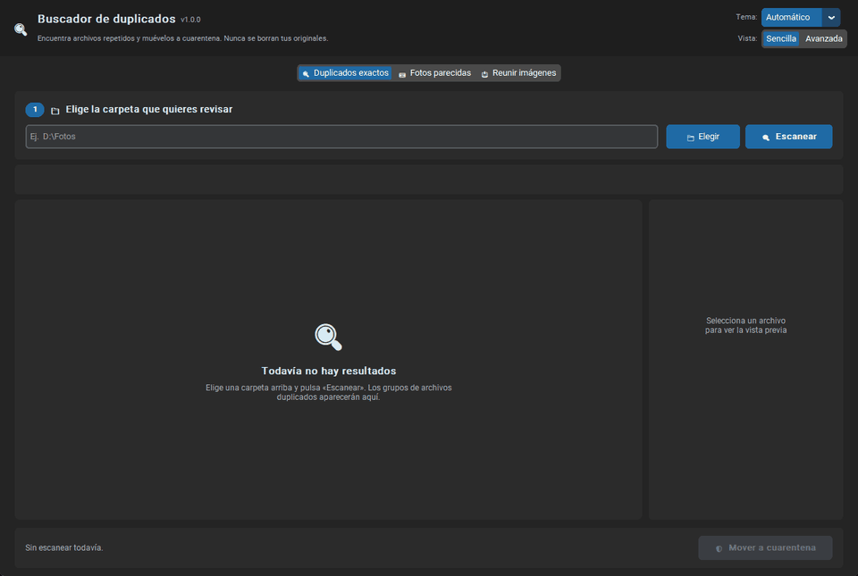
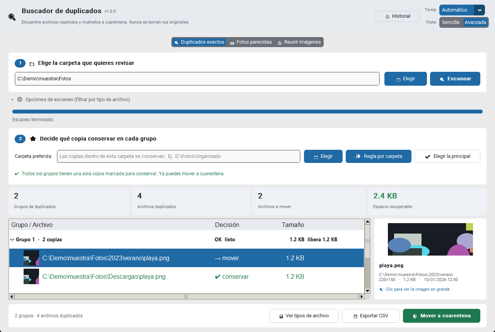
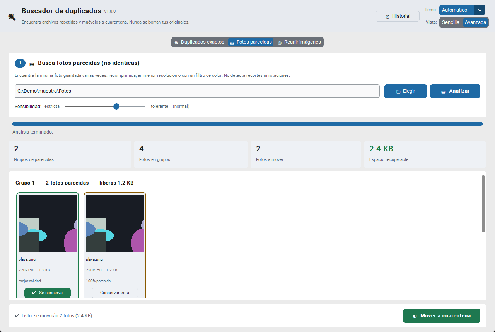
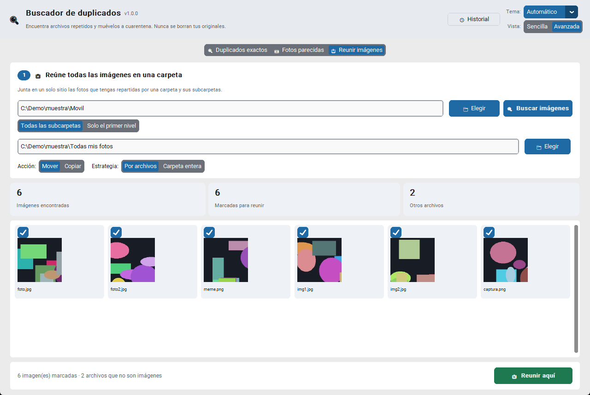
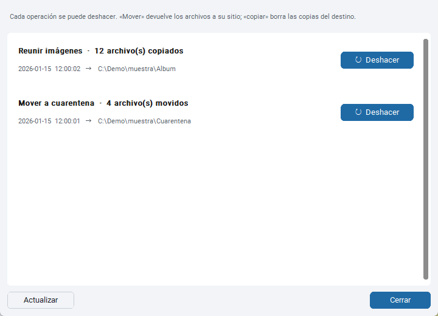

# Buscador de duplicados

[English](README.en.md) · **Español**

[](https://github.com/Sayessol/buscador-de-duplicados/actions/workflows/tests.yml)


App de escritorio para Windows que **encuentra archivos duplicados y fotos parecidas**, y te ayuda a ordenarlos sin riesgo.

> **Regla de oro: la app nunca borra ni modifica tus archivos originales.**
> Solo lee, y solo *mueve* a una carpeta de cuarentena cuando tú lo confirmas. Todo se puede deshacer.
>
> La única vez que la app borra algo es al **deshacer una copia**: elimina las copias que ella misma creó, y antes te pide confirmación.

<p align="center">
  
</p>

<p align="center">
  <a href="https://github.com/Sayessol/buscador-de-duplicados/releases/latest/download/Buscador-de-duplicados.exe"><b>⬇ Descargar para Windows (.exe)</b></a>
  · <a href="https://github.com/Sayessol/buscador-de-duplicados/releases/latest/download/Buscador-de-duplicados-portable.zip">versión ZIP</a> si tu antivirus bloquea el <code>.exe</code> · no necesita instalar Python
</p>

Nació de una necesidad mía y de un script de 150 líneas ([`docs/origin/buscar_duplicados.py`](docs/origin/buscar_duplicados.py)), y creció hasta ser una aplicación completa con interfaz gráfica, pruebas automáticas, integración continua y un `.exe` de un solo archivo. [Aquí cuento cómo nació](#cómo-nació-este-proyecto).

> 📚 **Proyecto de aprendizaje.** Lo hice para profundizar en Python partiendo de un nivel básico, con Claude como copiloto. [Más abajo](#por-qué-existe-este-proyecto) explico qué significa eso.

## Qué hace

| Pestaña | Para qué sirve |
|---|---|
| **Duplicados exactos** | Encuentra archivos idénticos byte a byte, aunque tengan nombres distintos. Muestra miniatura y vista previa, y elige sola la copia principal. |
| **Fotos parecidas** | Agrupa la misma foto guardada varias veces: recomprimida, en menor resolución o con un filtro. Conserva la de mejor calidad. |
| **Reunir imágenes** | Junta en una carpeta común las fotos repartidas por muchas subcarpetas (mover o copiar, por archivos o carpeta entera). |

Además:

- **Modo Sencilla / Avanzada.** Arranca en Sencilla (carpeta → escanear → mover) y recuerda tu elección.
- **Historial y deshacer.** Cada movimiento queda registrado y se puede revertir.
- **Visor de imagen** con zoom y desplazamiento para comparar detalles.
- **Tema claro, oscuro o automático** (sigue a Windows), con contraste WCAG AA y botones deshabilitados claramente distintos de los de error.
- **Filtros** por categoría (imágenes, audio, vídeo, documentos, comprimidos), extensión, nombre, carpeta y tamaño.
- **Interfaz en español de España.**

<details>
<summary>Capturas (se adaptan a tu tema de GitHub)</summary>

<picture>
  <source media="(prefers-color-scheme: dark)" srcset="docs/img/02_avanzada.png">
  
</picture>

<picture>
  <source media="(prefers-color-scheme: dark)" srcset="docs/img/04_parecidas.png">
  
</picture>

<picture>
  <source media="(prefers-color-scheme: dark)" srcset="docs/img/05_reunir.png">
  
</picture>

<picture>
  <source media="(prefers-color-scheme: dark)" srcset="docs/img/07_historial.png">
  
</picture>

</details>

## Cómo nació este proyecto

Siempre he guardado copias de seguridad de mis dispositivos antiguos, como teléfonos u ordenadores, en discos duros externos de varios teras. Con el tiempo, muchos archivos acaban duplicados en subcarpetas, y eso termina comiéndose el espacio del disco.

Revisarlo a mano es tedioso, y se vuelve incluso un lío cuando ya no sabes qué carpetas has revisado y cuáles no. Mi idea de partida era poder lanzar órdenes rápidas y sencillas que compararan imágenes y otros tipos de archivos y me dijeran enseguida si había duplicados o no. Descubrí que la forma más rápida de conseguirlo era usar Python.

Empecé con un script sencillo de unas 150 líneas ([`docs/origin/buscar_duplicados.py`](docs/origin/buscar_duplicados.py)): le introducía la ruta de una carpeta y me decía si había archivos duplicados y cuántos había analizado. Tras usarlo varias veces me di cuenta de que era poco práctico: tener que escribir la ruta cada vez era lento. Así que decidí crearle una interfaz para que fuese más fácil de usar.

Al construir la interfaz vi que podía añadirle funciones que adaptaran mejor la búsqueda a lo que yo quería. Así, lo que empezó siendo un script pasó a ser un programa de escritorio completo, con varias funciones y opciones de filtrado.

| Etapa | Qué había |
|---|---|
| 1. Una necesidad | Copias de seguridad con archivos duplicados que se comen el espacio del disco |
| 2. Un script | 150 líneas: una ruta de entrada, y me decía si había duplicados y cuántos archivos analizó |
| 3. Una interfaz | Para no tener que escribir la ruta cada vez |
| 4. Un programa de escritorio | Varias funciones y opciones de filtrado, hechas a medida de lo que yo quería |

## Por qué existe este proyecto

Además de resolver esa necesidad, es un **proyecto de aprendizaje**. Lo hice para **profundizar en Python y aprender**, partiendo de un **nivel básico**: quería enfrentarme a un problema real de principio a fin, y no solo a ejercicios sueltos.

Para conseguirlo, el proyecto toca temas que no suelen aparecer en los primeros ejercicios: algoritmos de búsqueda de duplicados (hashing, hash perceptual, BK-tree), hilos y colas para que una ventana no se quede bloqueada, interfaces gráficas, pruebas automáticas, integración continua y empaquetado de un programa para Windows.

**Qué significa para quien lo revise:** no es código de una persona experta, y no lo presento como tal. Es un ejercicio de aprendizaje hecho en serio, con sus límites a la vista (ver [Limitaciones conocidas](#limitaciones-conocidas)). Las mejoras que vaya haciendo quedarán anotadas en el [CHANGELOG](CHANGELOG.md) y forman parte de ese aprendizaje.

## Qué he aprendido

- **Lo que más me costó:** cómo dividir el código para que no quedaran archivos demasiado largos. Se nota en la estructura actual: la lógica (`core/`) separada de la interfaz (`ui/`) y un componente por pestaña.
- **Lo que más he aprendido:** la versatilidad de Python para ejecutar scripts directamente sobre los archivos: con muy pocas líneas se puede recorrer un disco, comparar contenidos y mover archivos.

## Lo que encontré probándola

Probé la app yo mismo, con mis propios archivos, y estos fueron los problemas que encontré y que cambiaron el programa:

- **El `.exe` no arrancaba.** Al descargar el ejecutable de la release me salió el error «Failed to start embedded python interpreter». Era mi antivirus (Avast), que retiene unos minutos el archivo único la primera vez que se abre. Por eso cada versión incluye también un ZIP con carpeta, que no tiene ese problema.
- **La galería de «Fotos parecidas» se cortaba.** Con muchas fotos, algunas imágenes aparecían cortadas y a la derecha había un hueco con aspecto de barra de desplazamiento que no existía. Resultó ser un límite de Windows con las ventanas muy altas, y ahora los grupos se reparten en páginas.
- **«Reunir imágenes» movía carpetas en vez de fotos.** Lo vi probándola y se corrigió; hay una prueba automática que lo comprueba.
- **Mis móviles no aparecían.** Pregunté si la app podía leer un teléfono conectado por USB. No es posible: Windows no les da una ruta de carpeta normal. Quedó anotado en las [limitaciones](#limitaciones-conocidas), con la solución de copiar antes las fotos al PC.
- **Las capturas no debían mostrar mi usuario de Windows.** Pedí que las imágenes y el GIF del README usaran una carpeta de ejemplo, y no una ruta con mi nombre.

## Cómo se ha hecho: con Claude como copiloto

Lo construí **trabajando con [Claude](https://claude.com/claude-code) (Anthropic) como copiloto de programación**, y quiero que quede claro:

- **Yo (Sayessol)** decidí qué construir y en qué orden, probé la app a mano, planteé las dudas y los problemas que fui encontrando (por ejemplo, si movía carpetas en vez de fotos) y fui aprobando cada paso.
- **Claude** escribió el código, las pruebas y la documentación, propuso alternativas y explicó sus decisiones, siempre dentro de las reglas del proyecto (como la de no borrar nunca los originales). La [guía del código](docs/guia-del-codigo.pdf) está escrita precisamente para aprender de ese código.
- **Por eso no presento este código como escrito solo por mí.** Lo que sí es mío es el objetivo, lo que se decidió construir y el aprendizaje que busco con ello.
- **Las pruebas son la red de seguridad**: ningún cambio se da por bueno sin las 196 pruebas en verde, y el CI las vuelve a ejecutar en cada *push*.
- Los commits llevan la línea `Co-Authored-By: Claude` para que la autoría compartida sea visible en el historial.

## Descarga y ejecución

Si solo quieres usarla, baja uno de estos archivos desde **[Releases](https://github.com/Sayessol/buscador-de-duplicados/releases)**:

| Archivo | Cuándo usarlo |
|---|---|
| `Buscador-de-duplicados.exe` | Un solo archivo: doble clic y listo. Es lo más cómodo. |
| `Buscador-de-duplicados-portable.zip` | Descomprímelo en una carpeta con **ruta corta** (por ejemplo `C:\Apps`) y abre el `.exe` de dentro. **Úsalo si tu antivirus bloquea o retrasa el `.exe` único.** |

> **Avisos de Windows y antivirus.** El programa no está firmado digitalmente (el certificado es de pago), así que SmartScreen puede avisar. Además, el `.exe` de un solo archivo se descomprime en una carpeta temporal cada vez que se abre, y algunos antivirus (por ejemplo Avast) lo retienen unos minutos la primera vez. La versión ZIP no extrae nada al arrancar y da muchos menos problemas.

Desde el código (Python 3.12 en Windows):

```bash
pip install -r requirements.txt
python app.py
```

Para generar tu propia versión:

```bash
python build_exe.py                  # un solo archivo: dist/duplicados.exe
python build_exe.py --folder --zip   # carpeta + ZIP:    dist/Buscador-de-duplicados.zip
```

## Cómo funciona por dentro

**Duplicados exactos: 3 pasadas**, para leer lo mínimo posible:

1. **Tamaño.** Se agrupan los archivos por tamaño en bytes. Si un tamaño es único, no puede tener duplicado y no se lee.
2. **Hash parcial.** Para los que comparten tamaño, BLAKE2b de los primeros 64 KB.
3. **Hash completo.** Solo para los que siguen coincidiendo. Si el hash completo coincide, son idénticos.

**Fotos parecidas** (`core/perceptual.py`): hash perceptual **dHash de 64 bits** (compara píxeles adyacentes en una miniatura en gris) más una **firma de color 4×4**. La búsqueda usa un **BK-tree** sobre la distancia de Hamming, para no comparar todas contra todas, y **Union-Find** para unir cadenas (A~B y B~C ⇒ {A, B, C}). Detecta recompresión, reescalado y filtros; **no** detecta recortes ni rotaciones.

**Interfaz sin bloqueos:** el trabajo pesado va en un hilo y manda mensajes por una `queue.Queue`; el hilo principal los lee con `after()` y es el único que toca los widgets (Tkinter no es seguro entre hilos).

**Seguridad al mover:** `shutil.move`, nombres con colisión resueltos como `nombre (1).ext`, la cuarentena no puede estar dentro de la carpeta escaneada, y CSV de registro de cada operación.

### Decisiones de diseño

| Decisión | Por qué |
|---|---|
| **Nunca borrar tus originales; mover a cuarentena** | Un error de la app no puede costarte datos. Lo que se mueve se puede devolver. |
| **BLAKE2b** | Está en la librería estándar, es más rápido que SHA-256 y de sobra fiable para detectar archivos idénticos. |
| **Hash parcial antes del completo** | La mayoría de archivos con el mismo tamaño ya difieren en los primeros 64 KB; así no se leen enteros. |
| **dHash y no OpenCV** | Cubre recompresión, reescalado y filtros con muy poco peso. OpenCV (para recortes y rotaciones) multiplicaría el tamaño del `.exe`. |
| **Lógica (`core/`) separada de la interfaz (`ui/`)** | `core/` no importa nada de la ventana, así que se prueba entera por consola y con pytest. |
| **Una pestaña = un componente** | `ui/main_window.py` es una carcasa de ~200 líneas; cada pestaña es un componente con su propio estado (`ExactDuplicatesTab`, `SimilarPhotosTab`, `GatherImagesTab`) y la ventana solo le pasa el modo y el cierre. |

### Rendimiento

`python tests/benchmark.py` genera 4.000 archivos (830 MB, con copias exactas y «casi duplicados» a propósito) y compara con hashear todo el contenido:

| Método | Tiempo | Bytes leídos |
|---|---|---|
| Hashear todo (ingenuo) | 2,02 s | 830 MB (100 %) |
| **3 pasadas (esta app)** | **0,90 s** | **284 MB (34 %)** |

Encuentran **exactamente los mismos 386 grupos**. Lee un 66 % menos de datos. Los tiempos son con los archivos en caché del sistema; en un disco «frío» la diferencia a favor de las 3 pasadas es mayor, porque ahí manda la lectura.

## Calidad del código

- **196 pruebas con pytest** (15 suites de lógica y de ventana + 181 unitarias), con **93 % de cobertura del núcleo y 79 % de la interfaz**.
- **ruff** como linter y **mypy** para comprobar los tipos del núcleo (`core/`, completamente anotado), y todo se ejecuta en **GitHub Actions** en cada push.
- **Registro de errores** en un archivo (`%APPDATA%\BuscadorDuplicados\logs\app.log`), con rotación, y un aviso claro al usuario si algo inesperado falla. Las pruebas nunca tocan los datos reales de la app.
- Las pruebas **no simulan el sistema de archivos**: crean archivos reales en carpetas temporales y comprueban el resultado en disco (incluida la comprobación de que se mueven *archivos* y no carpetas).
- **Contraste WCAG AA** en tema claro y oscuro, comprobado con medición.

```
core/      Lógica pura, sin interfaz (librería estándar + Pillow para las fotos)
ui/        Interfaz CustomTkinter; un componente por pestaña (pestana_*.py)
tests/   15 suites + pruebas unitarias + benchmark
docs/      Manual de usuario, guía del código y proceso de creación (PDF)
```

```bash
pip install -r requirements-dev.txt
pytest                    # todo (las pruebas de ventana necesitan escritorio de Windows)
pytest -m "not gui"       # solo lógica, sin abrir ventanas
pytest --cov              # con cobertura (núcleo e interfaz)
ruff check .
python -m mypy            # tipos del núcleo
```

## Documentación

Tres PDF con portada e índice, en [`docs/`](docs/):

- [Manual de usuario](docs/manual-de-usuario.pdf)
- [Guía del código](docs/guia-del-codigo.pdf): cómo está construida, pensada para quien quiere aprender.
- [Proceso de creación](docs/proceso-de-creacion.pdf): fases y decisiones.

## Limitaciones conocidas

- **No lee móviles conectados por USB** (modo MTP/PTP): Windows no les da una ruta de carpeta real. Copia antes las fotos al PC o usa un lector de tarjetas.
- Las fotos parecidas no detectan recortes ni rotaciones.
- Solo Windows.

## Sugerencias

No hay una hoja de ruta cerrada: iré mejorando la aplicación sobre la marcha, según vea con la práctica qué funciones le faltan. **Si tienes ideas para funcionalidades futuras, me encantará conocerlas**: abre una *issue* con la plantilla «Suggestion».

## Licencia

[MIT](LICENSE) © 2026 Sayessol
